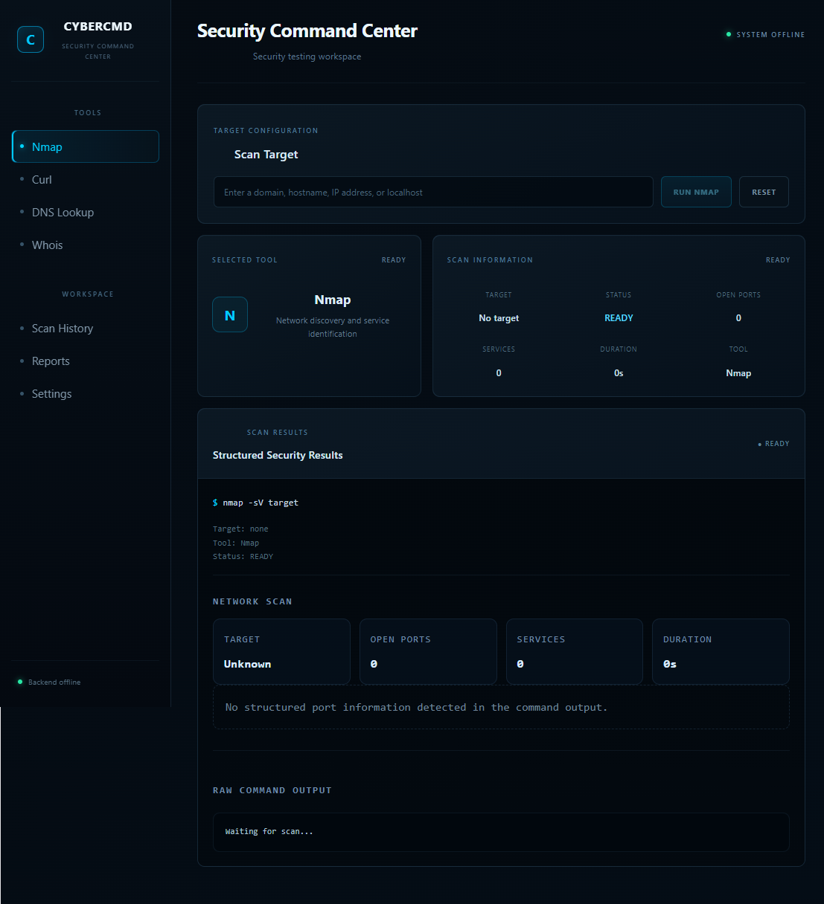
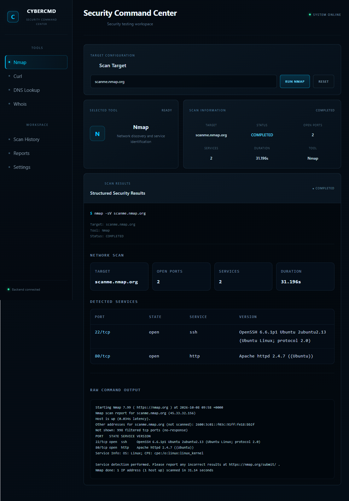
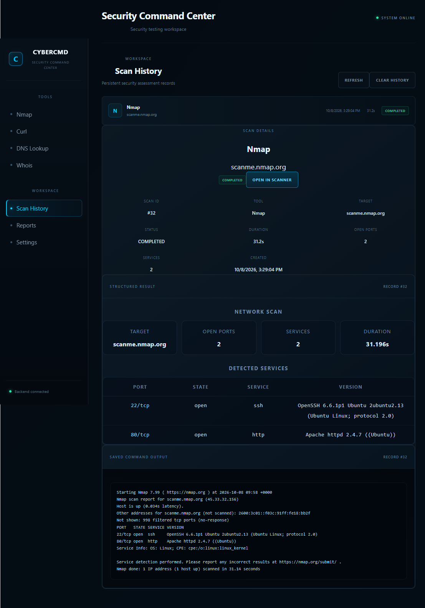

# CYBERCMD

### Cyber Command Center — Security Testing Workspace

CYBERCMD is a security testing dashboard I built to bring common reconnaissance and web-testing tools into one place.

Instead of running every tool separately from the terminal, CYBERCMD provides a simple interface to run scans, view results, and keep scan history.

> **Status:** Core version completed and tested.

## What it can do

* Run **Nmap** scans
* Make **cURL** requests
* Perform **DNS lookups**
* Query **Whois / RDAP**
* Store scan results in **MySQL**
* View previous scans through **Scan History**
* Run the project using **Docker**

## Screenshots

### Dashboard



### Nmap Scan



### Scan History



## Tech Stack

* React + Vite
* Node.js + Express
* MySQL
* Docker
* Nmap
* cURL
* DNS / RDAP

## How it works

```text
User
  ↓
CYBERCMD Dashboard
  ↓
Select Tool + Target
  ↓
Backend API
  ↓
Security Tool
  ↓
Result
  ↓
MySQL Scan History
```

## Project Structure

```text
cybercmd/
├── backend/
│   ├── server.js
│   ├── routes/
│   ├── services/
│   ├── validators/
│   └── config/
│
├── frontend/
│   └── src/
│
├── docs/
│   └── screenshots/
│
└── docker-compose.yml
```

## Running Locally

### 1. Clone the repository

```bash
git clone https://github.com/p7ihu2/cybercmd.git
cd cybercmd
```

### 2. Configure the backend

Create:

```text
backend/.env
```

and add your local MySQL configuration.

### 3. Start the backend

```bash
cd backend
npm install
node server.js
```

### 4. Start the frontend

```bash
cd frontend
npm install
npm run dev
```

Then open:

```text
http://localhost:5173
```

## Docker

The project also includes Docker configuration for running the application with MySQL.

```bash
docker compose up --build
```

## Security

Some basic protections are included in the backend:

* Input validation
* Helmet security headers
* Rate limiting
* Command execution without shell interpolation
* Execution timeouts
* Output size limits
* Environment variables for configuration

## Roadmap

Currently implemented:

* [x] Nmap
* [x] cURL
* [x] DNS Lookup
* [x] Whois / RDAP
* [x] MySQL scan history
* [x] Docker setup
* [x] Dashboard

Planned:

* [ ] WhatWeb
* [ ] Nikto
* [ ] Gobuster
* [ ] Better reporting
* [ ] More reconnaissance features

## Why I built it

I wanted to build something that connects the tools I am learning in cybersecurity with actual development.

CYBERCMD is also a way for me to practice backend development, API integration, databases, Docker, and security-focused programming in one project.

## Disclaimer

CYBERCMD is intended for security testing on systems you own or have permission to test.

## Author

**Surya Monalisha**

Cybersecurity Learner | Security Research Enthusiast
